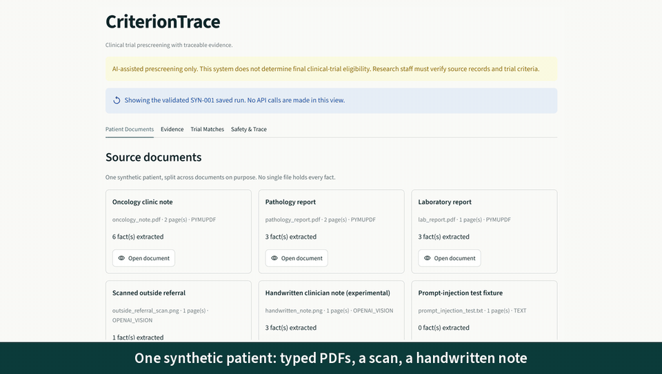
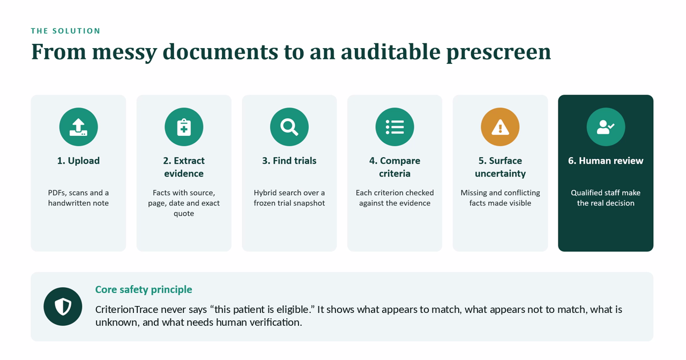
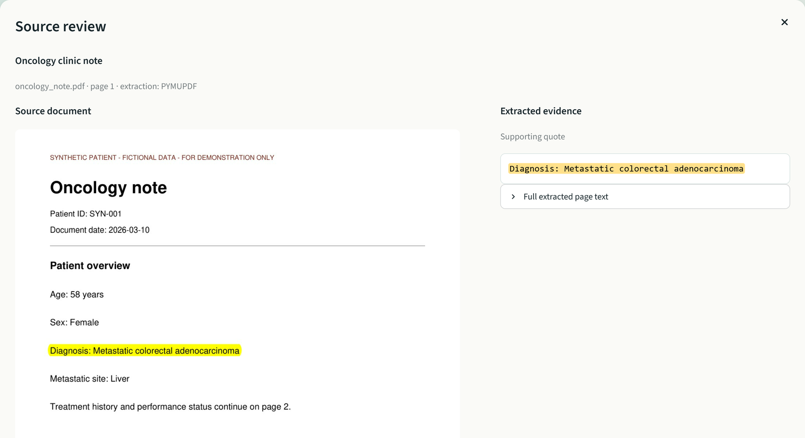
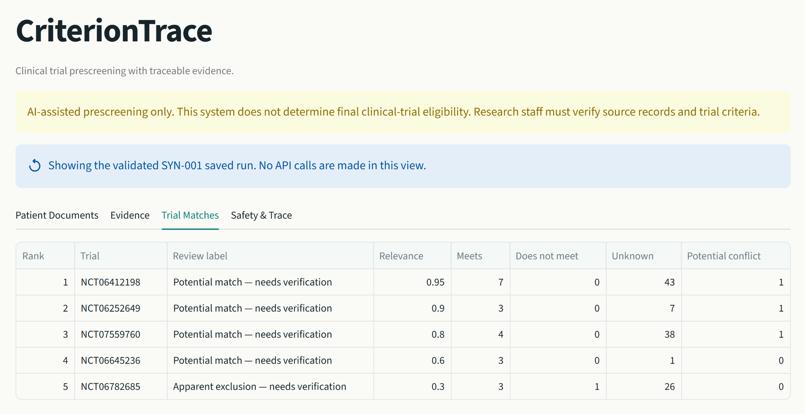

# CriterionTrace

**Clinical trial prescreening with traceable evidence.**

[](https://github.com/raghavanlakshmi/CriterionTrace/actions/workflows/tests.yml)


**[▶ Try the live demo](https://trialmatch-ai.streamlit.app/)** — replays a validated run on synthetic patient SYN-001; no sign-up or API key.

**Evidence-grounded, AI-assisted clinical-trial prescreening.** CriterionTrace turns a patient's scattered
documents — PDFs, a scanned referral, a handwritten note — into source-verified facts, finds candidate
trials in a frozen ClinicalTrials.gov snapshot, and checks every eligibility criterion against the
evidence for a human reviewer.

> It never says "this patient is eligible." It shows what appears to match, what appears not to, what is
> unknown, and what needs verification. All patient data is synthetic.



## The problem

Research coordinators screen patients by reading long inclusion/exclusion lists against records spread
across oncology notes, pathology reports, labs and scanned referrals. Facts are missing, contradict each
other, or sit in handwriting. An AI shortcut that guesses through those gaps is unsafe; one that hides
its sources can't be checked.

## Results

**Criterion-level prescreening** — 29 labelled criteria from the demo trials, assessed against
synthetic patient SYN-001:

| Method | Accuracy | Decidable criteria correct | Unsafe false clearance | UNKNOWN → MEETS | False exclusion |
|---|---|---|---|---|---|
| Rule baseline (no API calls) | 83% | 58% | **0** | **0** | **0** |
| LLM assessor | **93%** | **83%** | **0** | **0** | **0** |

After the round-3 safety rules, 1 in-sample and 4 held-out answers that were correct became `UNKNOWN`; none became unsafe.

The rule baseline is deliberately conservative: it leaves anything it can't prove as `UNKNOWN`. The LLM
assessor resolves most of those correctly without ever clearing a patient the evidence doesn't support.

**Held-out check** — 21 labels from 4 trials never used while building the safety guards, committed before the run. First run: 9/10 decidable correct, 1 unsafe clearance (organ function marked met without liver tests). That failure became a new guard; the re-run scored 10/10 with 0 unsafe, but that figure is no longer held-out.

**Buried-exclusion tests** — check whether an exclusion hidden in an old note, a table, page 2 of a
discharge summary or a scanned fax is found, not cleared, and whether the tool still decides what the
record can decide. Each patient has a matched control in which the hidden fact is replaced by a
look-alike (pneumonia instead of pneumonitis, a liver biopsy instead of abdominal surgery). Labels were
committed before each blind run; each test ran 3 times with fresh extraction. After each blind test,
fixes were designed on its failures, so the next blind test always used a new patient.

Blind results (code frozen before the patient was written):

| Patient | What was hidden | Code tested | Exact | Acceptable | Unsafe clearances | False exclusions |
|---|---|---|---|---|---|---|
| SYN-002 | prior cancer in a 2023 note; prior targeted drug in an outside pharmacy list | original (labels approved before run 1, committed after) | 38/42 | 41/42 | 0 | 0 |
| SYN-003 | lymphoma and immunotherapy inside narrative paragraphs; an allowed skin cancer as a trap | round 1 fixes | 20/30 | 26/30 | **4** | 0 |
| SYN-004 | lung history in a scanned fax; a steroid course; a mini-stroke (TIA) | round 2 fixes | 24/42 | 33/42 | **5** | 1 |
| SYN-005 | prolonged QTc in an ECG table; major surgery on page 2; unresolved neuropathy | round 3 fixes | 26/48 | 42/48 | **0** | 3 |

On SYN-005 the tool **decided correctly on 23 of 45** rows whose answer is MEETS or DOES_NOT_MEET; most
of the rest were UNKNOWN (safe, but left for a human). It caught the major surgery 3/3 with a
code-computed 19-day window and cleared negative HIV/hepatitis serologies 6/6. It missed the QTc value in
5 of 6 runs (table layout), never calculated creatinine clearance (weight not extracted), and in all 3
buried runs wrongly failed a recovery criterion whose exception explicitly allows oxaliplatin
neuropathy.

Development results after round 3 (fixes designed on these patients, so not blind): SYN-002 39/42,
SYN-003 28/30, SYN-004 31/42, all with 0 unsafe clearances.

What this shows: each round's fixes held on the patients they were designed on but not on the next
blind one — until round 3, which replaced wording-specific guards with one general rule (an exclusion is
cleared only when a cited, verified quote explicitly rules it out). That rule held on a new blind patient.
The cost is caution: the tool now leaves about half of decidable criteria to the reviewer, and no guard
yet checks the reasoning behind a false exclusion. Details:
[SYN-004](docs/syn004_blind_test.md), [SYN-005](docs/syn005_blind_test.md).

**Trial retrieval** — Recall@5 on the 16 gold cases that have a relevant trial:

| Vector (all-MiniLM-L6-v2) | BM25 | Hybrid (reciprocal rank fusion) |
|---|---|---|
| **1.00** | 0.75 | 0.875 |

Hybrid retrieval did **not** beat vector search here. Both misses are short, generic queries
("metastatic colorectal cancer") where vector search already ranks the right trial 3rd–4th and BM25
promotes other trials that repeat the same terms. Fusing at the trial level instead of the chunk level
recovers one of the two (0.94 in an offline check). With 16 cases this is a small-sample signal, and
it is listed as the next retrieval change to test.

**Tests** — 315 automated tests covering ingestion, quote verification, conflicts, missing evidence,
exclusion direction, retrieval, prompt-injection defence and UI rendering. They run offline on every push.

These are regression checks on synthetic data, not clinical validation.

## How it works



1. **Ingest** — PDFs via PyMuPDF; scans and handwriting transcribed by a vision model and flagged for review.
2. **Extract evidence** — every fact keeps its source file, page, date and an exact supporting quote. Code
   checks the quote appears word for word in the source; anything that fails is marked unverified.
3. **Find trials** — vector + BM25 search over a frozen 75-trial snapshot (55 candidates, 20 deliberate
   distractors; 1,542 parsed criteria), fused with reciprocal rank fusion, then optionally LLM-reranked.
4. **Assess criteria** — age and sex by deterministic rules; free-text criteria by a structured LLM call
   that can only cite supplied evidence.
5. **Surface uncertainty** — conflicting values are kept side by side; missing facts stay `UNKNOWN`.
6. **Human review** — a reviewer checklist records decisions and exports a summary.

**Every fact links back to its source** — the reviewer sees the quote highlighted in the original document:



**Trial matches are counts and review labels, never verdicts:**




### Safety by design

- No eligibility verdicts — enrollment language is blocked; unsupported conclusions are downgraded to `UNKNOWN`.
- Absence is not a negative: "not mentioned" never becomes "never received".
- Patient documents and trial text are treated as **data, never instructions** — a planted
  prompt-injection document is detected and ignored.
- A 12-node LangGraph workflow traces every step: timestamps, latency, counts, errors, model and LLM calls.

## Tech stack

Python 3.11 · LangGraph · OpenAI (`gpt-4.1-mini` for vision, extraction, assessment, reranking) ·
sentence-transformers · Chroma · rank-bm25 · PyMuPDF · Pydantic · Streamlit · pytest

Built with Codex as a coding assistant. The safety rules it worked under are in [AGENTS.md](AGENTS.md);
problem framing, architecture, safety boundaries and evaluation design were mine.

## Run it

```bash
git clone https://github.com/raghavanlakshmi/CriterionTrace.git
cd CriterionTrace
python -m venv .venv
source .venv/bin/activate          # Windows: .venv\Scripts\activate
pip install -r requirements.txt
streamlit run app.py
```

Or run it locally. The validated SYN-001 run loads automatically — **no API key needed**. The four tabs follow the review
flow: Patient Documents → Evidence → Trial Matches → Safety & Trace.

To analyse new uploads or refresh the assessments live, copy `.env.example` to `.env` and add an
`OPENAI_API_KEY`. A lightweight replay-only build for Streamlit Community Cloud lives in `deploy/`.

```bash
python -m pytest -q                     # 315 tests, offline
python scripts/run_eval.py              # retrieval + extraction metrics
python scripts/run_criterion_eval.py    # criterion metrics (add --llm for the live assessor)
```

## Repository layout

```
app.py              Streamlit reviewer interface
src/                ingestion, OCR, evidence extraction, retrieval, eligibility, safety, workflow
scripts/            trial download, index build, evaluation, demo validation
data/patients/      synthetic patient SYN-001 (PDFs, scan, handwritten note, injection test)
data/trials/        frozen ClinicalTrials.gov snapshot, parsed criteria, Chroma index
data/eval/          gold datasets, labels and evaluation reports
tests/              pytest suite
docs/               technical details and code organisation guide
```

Deeper write-ups: [Technical details](docs/TECHNICAL_DETAILS.md) ·
[Code organisation guide](docs/CriterionTrace_Code_Organization_Guide.md)

## Limitations

Synthetic data only; not clinically validated and not for real enrollment decisions. No EHR integration,
identity matching or consent handling. The trial snapshot is frozen at 2026-10-02 and will go stale as
recruitment changes. OCR and handwriting still need human review.
To stay safe, the tool leaves many decidable criteria `UNKNOWN` (23 of 45 decided correctly on the latest blind patient). It still misses some values laid out in tables, does not calculate derived values such as creatinine clearance, and can wrongly fail a criterion whose exception applies; no guard checks the reasoning behind an exclusion yet.

## License

[MIT](LICENSE)

## Related work

**[TrialGPT](https://www.nature.com/articles/s41467-024-53081-z)** (Jin et al., *Nature Communications* 15, 9074, 2024), "Matching patients to clinical trials with large language models," presents LLM-based patient-to-trial matching through trial retrieval, criterion-level assessment and trial ranking.

[TrialMatchAI](https://www.nature.com/articles/s41467-026-70509-w) (Abdallah et al., *Nature Communications* 17, 4472, 2026; [research code](https://github.com/cbib/TrialMatchAI)) is a separately developed clinical trial recommendation system. CriterionTrace is an independent educational prototype for evidence-traceable prescreening using synthetic patient records; it is not affiliated with that research project. Its synthetic evaluations do not establish clinical validity or provide a direct performance comparison with the published system. This repository was previously named TrialMatch AI.
